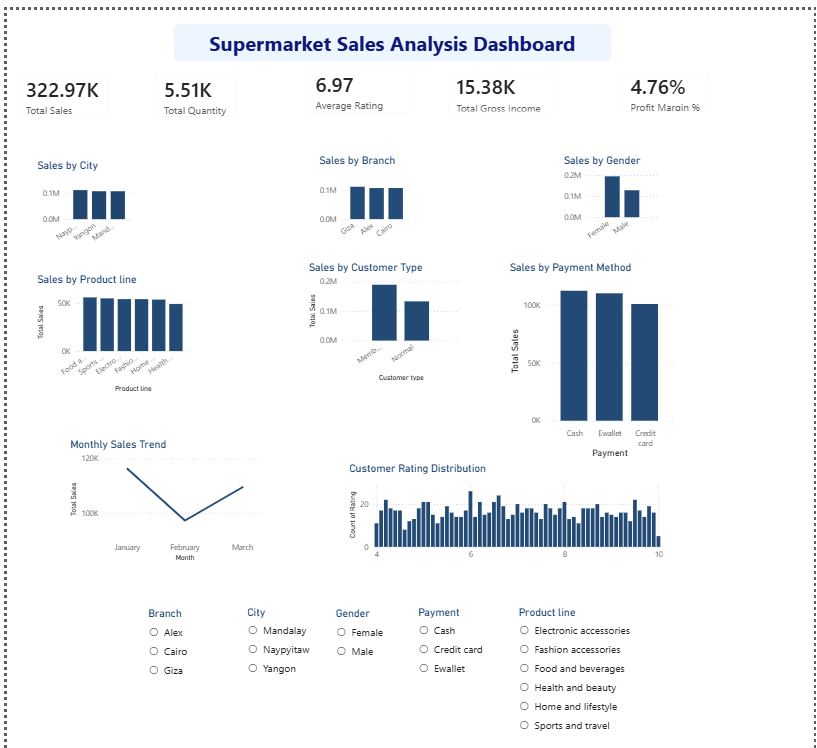

# Supermarket Sales Analysis

## Project Overview

This project analyses supermarket sales data to identify sales trends, customer purchasing patterns, product performance, and opportunities for business improvement.

The project uses Python, SQL (PostgreSQL), and Power BI to transform raw sales data into meaningful insights that can support data-driven business decisions.

## Project Objectives

- Analyse sales performance across branches and cities.
- Identify the best-performing product lines.
- Compare sales by customer type and gender.
- Examine payment methods and purchasing patterns.
- Explore monthly and hourly sales trends.
- Analyse customer ratings and their relationship with sales.
- Use SQL to answer business questions and summarise sales performance.
- Build an interactive Power BI dashboard.

## Tools and Technologies

- **Python:** Data analysis and data quality checks.
- **Jupyter Notebook:** Writing and executing Python code.
- **Pandas:** Data cleaning, manipulation, and analysis.
- **Matplotlib:** Data visualisation.
- **PostgreSQL:** Relational database for storing and querying sales data.
- **SQL:** Business analysis, aggregations, filtering, grouping, Common Table Expressions (CTEs), and CASE statements.
- **Power BI:** Interactive dashboard development and reporting.
- **Git and GitHub:** Version control and project portfolio management.

## Dataset Overview

The dataset contains 1,000 supermarket sales transactions recorded across three branches and cities over January, February, and March 2019.

The dataset includes information about:

- Branch and city
- Customer type and gender
- Product line
- Unit price and quantity
- Sales and gross income
- Payment method
- Transaction date and time
- Customer ratings

## Analysis Performed

### Python Analysis

- Data loading and exploration
- Data quality checks
- Sales by branch and city
- Sales by product line
- Sales by customer type and gender
- Payment method analysis
- Monthly and hourly sales trends
- Customer rating analysis
- Correlation analysis

### SQL Analysis

The sales dataset was imported into PostgreSQL, and 15 business-analysis queries were developed to investigate sales performance and customer purchasing patterns.

The SQL techniques used include:

- `SELECT` and `ORDER BY`
- Aggregate functions such as `SUM`, `COUNT`, and `AVG`
- `GROUP BY`
- Date and time analysis
- Common Table Expressions (CTEs)
- `CASE` statements for transaction classification
- Calculated metrics using aggregate functions

**SQL script:** [View the complete SQL analysis](SQL/supermarket_sales_analysis.sql)

## Key Findings

### Overall Sales Performance

- **Total sales:** 322,966.75
- **Total gross income:** 15,379.37
- **Total quantity sold:** 5,510 items
- **Total transactions:** 1,000

Gross income represents the dataset's gross income measure and should not be interpreted as net profit.

### Sales by City

- **Naypyitaw:** 110,568.71
- **Yangon:** 106,200.37
- **Mandalay:** 106,197.67

Naypyitaw generated the highest total sales, while Mandalay recorded the lowest. The difference between the highest and lowest cities was 4,371.04.

### Sales by Product Line

- **Food and beverages:** 56,144.84
- **Sports and travel:** 55,122.83
- **Electronic accessories:** 54,337.53
- **Fashion accessories:** 54,305.90
- **Home and lifestyle:** 53,861.91
- **Health and beauty:** 49,193.74

Food and beverages generated the highest sales, while health and beauty generated the lowest. The supermarket could investigate whether the lower-performing category has opportunities for improved promotion, product availability, or customer engagement.

### Branch Performance

Giza recorded the highest sales at 110,568.71 and the highest gross income at 5,265.18.

Cairo recorded the lowest sales at 106,197.67 and the lowest gross income at 5,057.03.

Giza also had the highest average customer rating, at 7.07, while Cairo had the lowest, at 6.82.

### Customer Type

- **Members:** 189,694.76 in sales across 565 transactions.
- **Normal customers:** 133,271.99 in sales across 435 transactions.

Member customers generated 56,422.77 more sales than normal customers. Their average transaction value was also higher.

The supermarket could investigate which membership benefits and customer engagement strategies help retain members and encourage repeat purchases.

### Customer Gender

- **Female customers:** 194,671.84 in sales across 571 transactions.
- **Male customers:** 128,294.91 in sales across 429 transactions.

Female customers generated 66,376.93 more sales than male customers. They also had a higher average transaction value.

These results describe the observed purchasing patterns in this dataset and do not establish the causes of the differences.

### Payment Methods

- **Cash:** 112,206.57 in sales.
- **E-wallet:** 109,993.11 in sales.
- **Credit card:** 100,767.07 in sales.

Cash generated the highest total sales, followed by e-wallet payments. Credit card transactions generated the lowest total sales.

The supermarket could review payment preferences and ensure that customers have convenient payment options.

### Monthly Sales Trend

- **January:** 116,291.87
- **February:** 97,219.37
- **March:** 109,455.51

January recorded the highest monthly sales. Sales declined in February before recovering in March, although March sales remained below January's level.

Further investigation would be needed to determine the reasons behind these changes.

### Quantity Sold by Product Line

Electronic accessories recorded the highest quantity sold, at 971 items, while health and beauty recorded the lowest, at 854 items.

Food and beverages generated the highest sales revenue even though its quantity sold was lower than that of electronic accessories. This illustrates why both revenue and sales volume are useful for evaluating product performance.

### Customer Ratings

The correlation between sales and customer ratings was approximately **-0.04**, indicating almost no linear relationship between these two variables in the dataset.

The supermarket should not assume that higher sales automatically lead to higher ratings. It could investigate customer service, product quality, availability, and checkout efficiency to identify opportunities to improve satisfaction.

### Transaction Value Classification

For practice, SQL `CASE` statements were used to classify transactions into three groups based on sales value:

- **High:** 227 transactions, contributing 159,554.63 in sales.
- **Medium:** 363 transactions, contributing 119,743.98 in sales.
- **Low:** 410 transactions, contributing 43,668.14 in sales.

High-value transactions contributed the most revenue despite being the least frequent category. These thresholds were selected for analysis practice and are not official business classifications.

## Business Recommendations

Based on the findings, the supermarket could:

1. Investigate the sales performance of branches and cities to identify effective practices that may be transferable to other locations.
2. Review product availability and promotional strategies for lower-performing product lines.
3. Evaluate membership programmes and customer retention strategies.
4. Maintain convenient payment options that reflect customer preferences.
5. Investigate monthly sales fluctuations and possible seasonal patterns.
6. Monitor customer feedback and service quality alongside sales performance.
7. Track both sales revenue and gross income when evaluating performance, while recognising that gross income is not net profit.

## Power BI Dashboard

The interactive Power BI dashboard presents key performance indicators and visual comparisons of sales by city, branch, product line, month, payment method, customer type, and gender, alongside customer rating analysis.

Interactive slicers allow users to filter the results and explore different aspects of the dataset.

## Project Structure

- `Dataset/` — Source sales dataset.
- `Documentation/` — Supporting project documentation.
- `Images/` — Dashboard screenshots and project visuals.
- `PowerBI/` — Power BI report.
- `Python/` — Jupyter Notebook analysis.
- `SQL/` — PostgreSQL business-analysis queries.
- `README.md` — Project overview, methodology, findings, and recommendations.

## Conclusion

This project demonstrates an end-to-end data analytics workflow, from data exploration and quality checks to SQL querying, business analysis, and interactive Power BI reporting.

Using Python, PostgreSQL, and Power BI, the project identifies differences in sales performance across branches, cities, product lines, customer groups, and payment methods.

The findings demonstrate how data analysis can help businesses monitor performance, investigate purchasing patterns, and make more informed decisions.
